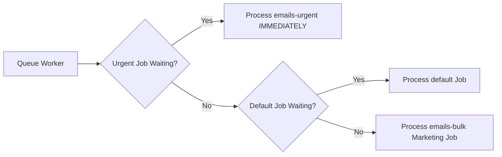
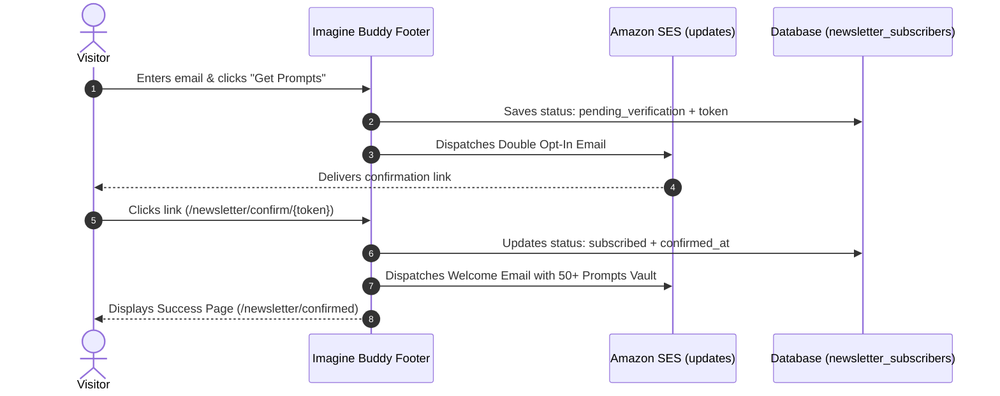

# 📘 Imagine Buddy: Administrator User Guide
## High-Deliverability Email Infrastructure, Marketing Studio & Lifecycle Automations

Welcome to the **Imagine Buddy Email & Marketing System** administrator guide. This manual provides clear, non-technical instructions, step-by-step workflows, best practices, and troubleshooting procedures for all 10 features implemented on your platform.

---

## 📑 Table of Contents
1. [Feature 1: Cloud Email Transport Engine (Amazon SES v2)](#feature-1-cloud-email-transport-engine-amazon-ses-v2)
2. [Feature 2: Prioritized 3-Tier Delivery Queues (Delivery Asynchrony)](#feature-2-prioritized-3-tier-delivery-queues-delivery-asynchrony)
3. [Feature 3: Domain Authentication & Reputation Guard (SPF, DKIM, DMARC)](#feature-3-domain-authentication--reputation-guard-spf-dkim-dmarc)
4. [Feature 4: Consent & Opt-In Audit Trail](#feature-4-consent--opt-in-audit-trail)
5. [Feature 5: High-Converting Newsletter & Lead Magnet Capture](#feature-5-high-converting-newsletter--lead-magnet-capture)
6. [Feature 6: Hardened Two-Factor Authentication (2FA OTP)](#feature-6-hardened-two-factor-authentication-2fa-otp)
7. [Feature 7: Automated Bounce & Complaint Suppression Firewall (AWS SNS)](#feature-7-automated-bounce--complaint-suppression-firewall-aws-sns)
8. [Feature 8: RFC 8058 One-Click Unsubscribe Engine](#feature-8-rfc-8058-one-click-unsubscribe-engine)
9. [Feature 9: Admin Marketing Studio, Visual Composer & Emergency Kill-Switch](#feature-9-admin-marketing-studio-visual-composer--emergency-kill-switch)
10. [Feature 10: Automated Lifecycle Campaigns & Customer Drips](#feature-10-automated-lifecycle-campaigns--customer-drips)
11. [Quick Reference & Master Command Summary](#quick-reference--master-command-summary)

---

## Feature 1: Cloud Email Transport Engine (Amazon SES v2)

### 1. What It Does
The Cloud Email Transport Engine replaces slow, traditional webmail (SMTP/cPanel) with enterprise-grade cloud delivery powered by **Amazon Simple Email Service (SES) v2** in the `ap-south-1` (Mumbai) region. It automatically segregates your email traffic into two dedicated subdomains:
* **`auth.imaginebuddy.com`**: Dedicated strictly to mission-critical transactional emails (login OTPs, password reset links, billing notifications).
* **`updates.imaginebuddy.com`**: Dedicated exclusively to marketing broadcasts, product announcements, weekly prompt drops, and newsletters.

### 2. Why to Use It
* **Protects Login Deliverability:** Sending a marketing broadcast will never slow down or risk the inbox placement of a user trying to log in or reset their password.
* **Virtually Unlimited Capacity:** Avoids the strict 500-email daily sending limits imposed by shared web hosts and standard Gmail accounts.
* **Instant Delivery:** Transactional emails reach inboxes in 1 to 3 seconds globally.

### 3. When to Use It
The engine runs automatically 24/7 in the background for every email generated by the platform. You never need to toggle it manually during daily operations.

### 4. How to Use It from the Admin Panel
1. Log in to your Admin Panel.
2. In the left sidebar, navigate to **Settings** &rarr; **Email Settings** (`/panel/admin/settings/email`).
3. Confirm the system addresses configured for your store:
   - **No-Reply Email Address:** `noreply@auth.imaginebuddy.com` (handles account verifications and security).
   - **Marketing / News Email Address:** `hello@updates.imaginebuddy.com` (handles announcements and campaigns).
   - **Admin Notification Email:** Your private email address where contact form alerts are received.
4. If you ever update sender identities, click **Save Changes**.

### 5. Best Practices
> [!TIP]
> Always let the system use the pre-configured subdomains. Never route marketing broadcasts through `auth.imaginebuddy.com`, as transactional reputation must remain 100% spotless.

### 6. Common Issues & Troubleshooting
* **Emails not delivering:** Verify your AWS SES Production status in the AWS Console. (Your account is already approved for production).
* **Connection refused error in logs:** Ensure your web hosting firewall permits outbound HTTPS traffic on port 443 to AWS endpoints (`email.ap-south-1.amazonaws.com`).
* **Check error details:** Review server logs located at `storage/logs/laravel.log`.

---

## Feature 2: Prioritized 3-Tier Delivery Queues (Delivery Asynchrony)

### 1. What It Does
The Prioritized 3-Tier Queue system decouples email dispatch from website response times. Instead of forcing a user to wait 3–5 seconds while an email server connects, the website responds in under 0.1 seconds, handing the message to a background queue processor divided into three distinct speed lanes:
1. **`emails-urgent` (Highest Priority):** Instant delivery for 2FA verification codes, password resets, and account activations.
2. **`default` (Normal Priority):** Background AI image generations, billing receipts, and general system notifications.
3. **`emails-bulk` (Standard Priority):** Marketing campaigns, weekly prompt drops, and re-engagement digests.



### 2. Why to Use It
* **Zero Waiting for Visitors:** Users experience lightning-fast page transitions upon clicking "Register", "Login", or "Checkout".
* **No Queue Jamming:** If you launch a 10,000-subscriber marketing campaign, an urgent login code will jump immediately to the front of the line and deliver without delay.

### 3. When to Use It
Runs continuously in the background via the server scheduler. You rely on this feature every time multiple emails are sent simultaneously.

### 4. How to Use It from the Admin Panel
* The queue processor operates automatically via your server's background scheduler (Cron).
* To verify that jobs are processing smoothly, you can visit **Admin Panel > Email Deliverability** (`/panel/admin/email-deliverability`) and send a test dispatch.
* If you manage your server via SSH, the worker command pre-configured in `app/Console/Kernel.php` is:
  ```bash
  php artisan queue:work --queue=emails-urgent,default,emails-bulk --stop-when-empty --tries=3 --timeout=120
  ```

### 5. Best Practices
* Ensure your hosting provider's cron job fires `php artisan schedule:run` every minute.
* Keep the worker timeout set to 120 seconds to prevent background jobs from hanging or consuming excessive RAM.

### 6. Common Issues & Troubleshooting
* **Emails remain queued and are not sent:** The background cron job may be paused or stopped. Check your hosting control panel (e.g., Hostinger/cPanel) under **Cron Jobs** to ensure `* * * * * php artisan schedule:run` is active.
* **Queue worker stopped unexpectedly:** Run `php artisan queue:restart` via terminal to clear stale workers and start fresh.

---

## Feature 3: Domain Authentication & Reputation Guard (SPF, DKIM, DMARC)

### 1. What It Does
Domain Authentication provides cryptographic verification that every email received by customers genuinely originated from Imagine Buddy and has not been forged, spoofed, or altered. It implements three industry standards:
* **DKIM (DomainKeys Identified Mail):** 2048-bit digital signatures attached to every email header via 3 CNAME DNS records per subdomain.
* **SPF (Sender Policy Framework):** Explicit DNS authorization instructing receiving servers that Amazon SES is permitted to send mail for your domains.
* **DMARC (`p=quarantine`):** A strict domain-level policy commanding Gmail, Yahoo, and Outlook to quarantine or reject any unauthorized emails attempting to impersonate Imagine Buddy.

### 2. Why to Use It
* **Mandatory for Gmail and Yahoo:** Starting in February 2024, unauthenticated senders face immediate delivery rejection or automatic placement into the Spam folder.
* **Guarantees Inboxing:** Ensures your emails consistently land in the primary inbox rather than the junk or spam folder.
* **Eliminates Spoofing:** Prevents scammers from sending fake emails claiming to be Imagine Buddy administrators.

### 3. When to Use It
Configured permanently at your DNS provider (Cloudflare). You review this setup whenever you add new domains or run deliverability health audits.

### 4. How to Use It from the Admin Panel
1. Go to **Admin Panel > Email Deliverability** (`/panel/admin/email-deliverability`).
2. Use the **Send Deliverability Test** panel on the right:
   - Enter your personal Gmail address.
   - Click **Send Real Test Dispatch**.
3. Open the test email in Gmail:
   - Click the three dots icon next to "Reply" and select **Show Original**.
   - Confirm that all three checks display a green pass:
     - **SPF:** `PASS`
     - **DKIM:** `PASS`
     - **DMARC:** `PASS`

### 5. Best Practices
> [!IMPORTANT]
> In Cloudflare DNS, always leave the Easy-DKIM CNAME records set to **DNS Only** (Grey Cloud). Never turn on Cloudflare Proxy (Orange Cloud) for email authentication records.

### 6. Common Issues & Troubleshooting
* **Gmail displays "Sent via amazonses.com":** This indicates Custom MAIL FROM is not configured or resolved. Check that the MX record for `mail.updates.imaginebuddy.com` points to `feedback-smtp.ap-south-1.amazonses.com`.
* **DKIM verification fails:** Check for trailing dots or missing characters in Cloudflare DNS CNAME records.

---

## Feature 4: Consent & Opt-In Audit Trail

### 1. What It Does
The Consent & Opt-In Audit Trail automatically captures and preserves legal proof of every user's permission to receive marketing communications:
* **Standard Registration Form (`/register`):** An explicit, opt-in consent checkbox.
* **Social Login (Google OAuth):** A legally binding pre-click consent notice: *"By continuing with social login, you agree to our Terms and Conditions and to receive platform updates. You can opt out anytime in settings."*
* **Audit Record:** Stores the user's opt-in state (`marketing_opt_in = 1`), exact timestamp (`marketing_opt_in_at`), and signup IP address (`marketing_opt_in_ip`).

### 2. Why to Use It
* **Zero-Cost List Safety:** Leverages your 1,794+ pre-verified Google OAuth users without paying third-party email verification services.
* **Full Legal Compliance:** Provides complete compliance with GDPR, CAN-SPAM, and CCPA regulations. If a user ever disputes an email, you have proof of consent.

### 3. When to Use It
Recorded automatically whenever a user creates an account or logs in with Google. Administrators consult these records when handling user privacy requests or consent inquiries.

### 4. How to Use It from the Admin Panel
1. Navigate to **Admin Panel > Members** (`/panel/admin/members`).
2. Use the search bar to find any member by name or email.
3. Click the member row to view their profile, account creation date, and status.
4. When drafting marketing campaigns, the system automatically filters and targets only members who have active consent.

### 5. Best Practices
* Never manually force a user's `marketing_opt_in` status to active without their explicit written request.
* If a customer requests data deletion or an opt-out via support, honor it promptly.

### 6. Common Issues & Troubleshooting
* **A user claims they did not sign up for emails:** Locate their record in the database or admin member list; you can verify their signup IP address and exact consent timestamp.
* **User wants to opt back in:** The user can re-enable marketing emails in their Account Settings or by entering their email in the website footer newsletter form.

---

## Feature 5: High-Converting Newsletter & Lead Magnet Capture

### 1. What It Does
Captures visitor email addresses directly from your website footer without requiring them to register an account. It executes a secure **Double Opt-In** verification loop:
1. Visitor submits their email in the footer.
2. The system checks syntax, verifies the suppression list, and sends a confirmation link.
3. The visitor clicks the link in their inbox (`/newsletter/confirm/{token}`).
4. Their record updates to `subscribed`, and the system automatically delivers the **50+ Master Prompts Vault** download.



### 2. Why to Use It
* **Grows Your Customer Pipeline:** Converts casual website visitors into loyal subscribers who can later be nurtured into paid customers.
* **Guarantees 100% Valid Emails:** Double opt-in ensures no typos, dead inboxes, or fake emails enter your database, protecting your sender score.
* **Bot-Proof Security:** Protected by a hidden honeypot field (`newsletter_check`) and client-side validation to block spam bots.

### 3. When to Use It
Active 24/7 on all public pages of Imagine Buddy.

### 4. How to Use It from the Admin Panel
1. Go to **Admin Panel > Email Deliverability** (`/panel/admin/email-deliverability`).
2. Click the **Newsletter Subscribers** tab.
3. Review the live subscriber table:
   - **Email:** The subscriber's address.
   - **Status Badge:** `Subscribed` (green) or `Pending Opt-In` (amber).
   - **Signup Source:** The specific page or URL where they submitted the form.
   - **Date Subscribed:** Exact signup date and time.

### 5. Best Practices
* Regularly update your **50+ Master Prompts Vault** content to ensure new subscribers receive high-value AI generation recipes.
* Never manually blast subscribers who remain in `Pending Opt-In` status; only verified subscribers should receive broadcasts.

### 6. Common Issues & Troubleshooting
* **Subscriber reports not receiving the confirmation link:**
  - Check the **Suppressions List** tab to confirm their address isn't blocked.
  - Advise them to check their Promotions or Spam folder and click "Not Spam".
* **Spam bots submitting forms:** Handled automatically by the built-in honeypot; bot submissions with filled honeypots are dropped silently without sending any email.

---

## Feature 6: Hardened Two-Factor Authentication (2FA OTP)

### 1. What It Does
Hardened 2FA OTP provides banking-grade security for user accounts and protects your email sending quota from being exploited:
* **6-Digit Cryptographic Code:** Generated using cryptographically secure random integers (`random_int(100000, 999999)`).
* **10-Minute Expiration (`expires_at`):** Codes strictly expire after 10 minutes.
* **Brute-Force Lockout:** Tracks failed guesses; invalidates the code after 5 failed attempts.
* **60-Second Cooldown:** Prevents email flooding by forcing users to wait 60 seconds before requesting another code.

### 2. Why to Use It
* **Stops Account Takeover:** Prevents hackers from guessing or stuffing passwords to hijack customer accounts.
* **Protects Email Reputation:** Stops malicious scripts from repeatedly triggering thousands of verification emails to exhaust your AWS SES quota.

### 3. When to Use It
Triggers automatically whenever a user with Two-Factor Authentication enabled logs in or requests a login confirmation code.

### 4. How to Use It from the Admin Panel
1. All administrators should navigate to **Account Settings** and enable **Two-Factor Authentication**.
2. If a customer contacts support reporting they are locked out:
   - Go to **Admin Panel > Members** (`/panel/admin/members`).
   - Locate the member and confirm their email address is correct.
   - If they exceeded the 5-attempt limit, their old code is invalidated; they can request a fresh code on the login page after the 60-second cooldown expires.

### 5. Best Practices
* Require all administrators and team members with Admin Panel access to keep 2FA enabled at all times.
* Advise users never to share their 6-digit OTP with anyone.

### 6. Common Issues & Troubleshooting
* **"Code has expired" message:** The user entered the code after the 10-minute window. They must click "Resend Code" to receive a fresh OTP.
* **"Maximum attempts exceeded":** The user failed 5 attempts. The code has been purged for security; the user must wait 60 seconds and request a new code.
* **OTP email not arriving:** Ensure the queue worker is running and that the customer's email is not on the suppression list.

---

## Feature 7: Automated Bounce & Complaint Suppression Firewall (AWS SNS)

### 1. What It Does
An automated, self-healing deliverability firewall that connects Amazon SES directly to your website using **Amazon SNS (Simple Notification Service)** webhooks:
* Listens at `POST /api/webhooks/aws-ses`.
* **Hard Bounces:** If an email is sent to an invalid or deleted address, Amazon SES notifies your site, which automatically records the address in `email_suppressions` with reason `hard_bounce`.
* **Spam Complaints:** If a recipient clicks "Report as Spam", the webhook automatically suppresses the email with reason `complaint`.
* **Automatic Opt-Out:** Instantly sets `marketing_opt_in = 0` on the `users` table and marks `newsletter_subscribers` as `unsubscribed`.
* **Pre-Send Filter:** Every outgoing marketing email checks `EmailSuppression::isSuppressed($email)`. Suppressed emails are permanently blocked from sending.

### 2. Why to Use It
* **Keeps You Below AWS Thresholds:** Amazon requires accounts to maintain a **bounce rate below 5%** (preferably < 2%) and a **complaint rate below 0.1%**. Exceeding these thresholds results in immediate SES suspension. This firewall ensures you never send to a dead or complaining inbox twice.
* **Completely Autonomous:** Requires zero daily manual data entry or list cleaning.

### 3. When to Use It
Operates 24/7 automatically. You use the admin interface to monitor deliverability health and assist customers who have fixed an inbox issue.

### 4. How to Use It from the Admin Panel
1. Go to **Admin Panel > Email Deliverability** (`/panel/admin/email-deliverability`).
2. Review the top KPI cards:
   - **Total Suppressed:** Total number of blocked addresses.
   - **Hard Bounces:** Addresses that do not exist.
   - **Spam Complaints:** Users who clicked "Report Spam".
   - **Manual Unsubscribes:** Users who opted out.
3. **To Search:** Enter an email into the search box to check if it has been blocked.
4. **To Unblock a Customer:**
   - If a customer contacts support stating their inbox was full but is now fixed, click the green **Unblock** button next to their row.
5. **To Manually Block an Address or Domain:**
   - Use the **"Manually Block / Suppress Email"** form on the right. Enter the email, select `Admin Suppressed`, and click **Suppress**.

### 5. Best Practices
> [!WARNING]
> Never unblock an email address that registered a hard bounce (non-existent mailbox) or a spam complaint unless the owner has explicitly confirmed in writing that the problem is resolved.

### 6. Common Issues & Troubleshooting
* **Webhook not recording bounces:** Ensure the Amazon SNS Subscription points to `https://imaginebuddy.com/api/webhooks/aws-ses` and displays "Confirmed" in the AWS SNS console. (Our controller automatically confirms SNS subscription requests).
* **Legitimate customer accidentally suppressed:** Simply click the green **Unblock** button in the Deliverability dashboard.

---

## Feature 8: RFC 8058 One-Click Unsubscribe Engine

### 1. What It Does
Implements the strict, standardized **RFC 8058 One-Click Unsubscribe** protocol across all marketing emails:
* Automatically injects mandatory email headers:
  ```http
  List-Unsubscribe: <https://imaginebuddy.com/newsletter/unsubscribe/{token}>
  List-Unsubscribe-Post: List-Unsubscribe=One-Click
  ```
* Displays a native, prominent **"Unsubscribe"** button at the very top of Gmail and Yahoo email apps.
* When a recipient clicks it, their email app sends an instant background POST request that unsubscribes them immediately without requiring a login or confirmation step.
* If a user clicks the link in a web browser, it gracefully displays a friendly confirmation page (`/newsletter/unsubscribed`).

### 2. Why to Use It
* **Mandatory Compliance:** Required by Google and Yahoo since February 2024 for all bulk and marketing senders.
* **Saves Domain Reputation:** When users cannot find an easy unsubscribe link, they click "Report Spam". A 1-click unsubscribe safely removes uninterested users without damaging your sender score.

### 3. When to Use It
Attached automatically to every broadcast campaign, prompt drop, and marketing automation.

### 4. How to Use It from the Admin Panel
* The feature is fully automatic and requires no manual setup when creating campaigns.
* To review unsubscribed users:
  1. Go to **Admin Panel > Email Deliverability** (`/panel/admin/email-deliverability`).
  2. Filter or search the list for reason `unsubscribed`.
  3. The system will never send marketing broadcasts to these addresses.

### 5. Best Practices
* Always maintain the visible unsubscribe link in your email footers as well. Our CKEditor presets already have this pre-formatted.
* Never attempt to obscure or remove unsubscribe links.

### 6. Common Issues & Troubleshooting
* **User claims they still received an email after unsubscribing:** Verify if the user has multiple accounts or email aliases registered under different addresses.
* **Unsubscribe link security:** All tokens are cryptographically generated and signed to prevent malicious third parties from unsubscribing other users.

---

## Feature 9: Admin Marketing Studio, Visual Composer & Emergency Kill-Switch

### 1. What It Does
A complete, self-hosted visual email marketing suite built right into your admin dashboard:
* Accessible at **Admin Panel > Email Campaigns** (`/panel/admin/email-marketing/campaigns`).
* **Visual CKEditor Composer:** Rich-text editing with support for images, styled buttons, headings, and dynamic tags (e.g. `{name}`, `{vaultUrl}`).
* **4 Pre-Designed 1-Click Template Presets:**
  - 🎨 *AI Prompts Showcase* (Featured prompt cards with preview badges and copy buttons).
  - 🚀 *Product / Feature Announcement* (Big hero banner, feature bullet list, and CTA button).
  - 🏷️ *Promotional Discount / Sale* (Promo code callout box, percentage discount, and shop button).
  - ✍️ *Minimalist Letter* (Clean, text-first format optimized for maximum inbox delivery).
* **Live Segment Audience Previewer:** Computes live recipient counts and shows a sample preview table before you send.
* **Dual Device Preview:** Instant live toggles between **Desktop (600px)** and **Mobile (375px)** views.
* **Live Real-World Test Dispatch:** Send an exact replica to your personal inbox with one click.
* **Emergency Bulk Email Kill-Switch:** A prominent safety switch at the top of the campaigns screen that immediately halts all active and queued marketing broadcasts.

### 2. Why to Use It
* **Zero Monthly SaaS Costs:** Eliminates the need to pay \$100–\$300/month for Mailchimp, Klaviyo, or Brevo.
* **Eliminates Mistakes:** Live preview and personal test sending allow you to spot formatting errors or broken links before broadcasting.
* **Total Control:** The Emergency Kill-Switch provides instant peace of mind if an unintended email is triggered.

### 3. When to Use It
Use this feature whenever you want to announce a new AI model, launch a seasonal discount, send product updates, or broadcast custom newsletters. Use the Kill-Switch during emergencies.

### 4. Step-by-Step Instructions

#### Creating & Sending a Campaign
1. Go to **Admin Panel > Email Campaigns** (`/panel/admin/email-marketing/campaigns`).
2. Click the blue **Create New Campaign** button.
3. At the top of the composer, click any of the **1-Click Template Presets** to load a pre-built layout.
4. Fill in the campaign metadata:
   - **Campaign Name:** Internal reference (e.g., *Black Friday 40% Off*).
   - **Email Subject Line:** Customer-facing subject (e.g., *Unlock 40% Off Imagine Buddy Pro This Weekend*).
   - **Pre-Header Snippet:** Preview text shown in the recipient's inbox preview.
5. Select your **Target Audience Segment**:
   - *All Deliverable Audience* (All verified Google OAuth users + double opt-in subscribers).
   - *Google OAuth Users Only*.
   - *Newsletter Subscribers Only*.
   - *Active Paid Subscribers Only*.
   - *Admin Test List Only* (Sends only to administrators).
6. Click **Preview Segment** to view the live recipient count and inspect sample recipients.
7. Customize the content inside the CKEditor canvas. You can use dynamic personalization tags:
   - `{name}` &rarr; Replaced with customer's first name.
   - `{email}` &rarr; Replaced with customer's email.
   - `{vaultUrl}` &rarr; Direct link to the Master Prompts Vault.
8. Check the **Live Email Preview** pane on the right; toggle between **Desktop** and **Mobile** to verify responsive layout.
9. **Send a Test Email:** In the "Send Real Test Preview" box, enter your email and click **Send Test**. Inspect it in your inbox.
10. Click **Send Campaign Now** to broadcast immediately, or **Save Draft** to edit later.

#### Using the Emergency Kill-Switch
If you accidentally broadcast an email with an error or need to stop marketing sends immediately:
1. Go to **Admin Panel > Email Campaigns** (`/panel/admin/email-marketing/campaigns`).
2. At the top of the screen, click the red button: **Engage Emergency Kill-Switch**.
3. Confirm the action.
4. **Immediate Effect:**
   - All bulk marketing broadcasts are frozen.
   - Pending marketing emails in the `emails-bulk` queue are automatically stopped.
   - **Critical Safety:** Transactional emails (login OTPs and password resets on `emails-urgent`) continue to function normally.
5. To restore normal operation once the issue is resolved, click the green button: **Release Kill-Switch & Resume**.

### 5. Best Practices
* Always send a test email to your personal inbox and click every link before broadcasting.
* Keep subject lines concise (under 50 characters) to avoid truncation on mobile screens.
* Avoid spam trigger words (e.g., "FREE MONEY", all-caps words, excessive exclamation marks).

### 6. Common Issues & Troubleshooting
* **Red "Emergency Kill-Switch Active" banner is visible:** Campaign creation is locked while the kill-switch is active. Click **Release Kill-Switch & Resume** to enable campaign sending.
* **Email formatting appears distorted in mobile preview:** Use the built-in 375px mobile toggle to adjust image sizes and button padding before broadcasting.
* **Pasting content into CKEditor brings unwanted styling:** Use `Ctrl + Shift + V` (Paste as plain text) to maintain clean HTML formatting.

---

## Feature 10: Automated Lifecycle Campaigns & Customer Drips

### 1. What It Does
A suite of intelligent, background marketing automations designed to nurture, retain, and re-engage users throughout their entire customer journey:

```mermaid
gantt
    title Automated Customer Lifecycle Schedule
    dateFormat  X
    axisFormat %d
    section Onboarding
    Double Opt-In & Lead Magnet Vault : 0, 1
    Day 3 Studio Masterclass Drip     : 3, 4
    section Weekly
    Tuesday Curated Prompt Drop       : 7, 8
    section Retention
    Abandoned Checkout Recovery       : 1, 2
    3-Day Subscription Expiry Alert  : 27, 28
    Monthly Quota Refilled Alert     : 30, 31
    30-Day Inactive Re-engagement     : 30, 32
```



1. **Day 3 Welcome Drip (`email:send-welcome-drip`):**
   - Automatically sent to users 3 days after signup.
   - Delivers *"3 Studio Lighting Secrets for Realistic AI Mockups"* to encourage active prompt generation.
2. **Weekly Curated Prompt Drop (`email:send-weekly-drop`):**
   - Dispatches every Tuesday at 10:00 AM UTC.
   - Automatically selects the top 3 newest prompts and photoshoots with direct 1-click links.
3. **3-Day Subscription Expiration Notice (`email:send-quota-alerts`):**
   - Runs daily at 09:00 AM UTC.
   - Identifies active subscriptions expiring in 72 to 48 hours and alerts the user to renew.
4. **Monthly Quota Refilled Alert (`email:send-quota-alerts`):**
   - Informs active subscribers when their monthly generation balance has been renewed.
5. **Abandoned Checkout Recovery (`email:send-abandoned-checkout`):**
   - Runs hourly in the background.
   - Detects users who initiated a checkout attempt between **2 and 24 hours ago** but did not complete payment.
   - Sends a recovery reminder with a direct link back to checkout.
   - Enforces a strict **30-day frequency cap** per customer so no one is spammed.
6. **30-Day Inactive Re-engagement (`email:send-reengagement`):**
   - Dispatches monthly on the 1st at 11:00 AM UTC to re-engage verified users who haven't logged in for 30+ days.

### 2. Why to Use It
* **Drives Recurring Revenue:** Recaptures abandoned sales and prevents subscription churn automatically.
* **Hands-Off User Engagement:** Keeps your platform top-of-mind every week without requiring manual weekly newsletters.

### 3. When to Use It
Lifecycle automations run automatically based on predefined server cron schedules.

### 4. How to Use It from the Admin Panel
* The automations run autonomously in the background.
* To check the status of automated dispatches:
  1. Go to **Admin Panel > Email Campaigns** (`/panel/admin/email-marketing/campaigns`).
  2. The **Campaign History** table logs completed and automated dispatches.
* Administrators with server access can manually trigger or test any automation using Artisan CLI:
  ```bash
  # Test the weekly prompt drop:
  php artisan email:send-weekly-drop

  # Test the welcome drip:
  php artisan email:send-welcome-drip

  # Test abandoned checkout recovery:
  php artisan email:send-abandoned-checkout

  # Test quota & expiration notices:
  php artisan email:send-quota-alerts
  ```

### 5. Best Practices
* Periodically review the prompts featured in the weekly drop to ensure the highest visual quality.
* All lifecycle campaigns automatically respect suppression lists and unsubscribe requests.

### 6. Common Issues & Troubleshooting
* **Customers receiving duplicate alerts:** The database schema includes built-in frequency caps (`welcome_drip_sent_at`, `last_expiration_alert_sent_at`, and `abandoned_checkout_logs`) to guarantee each alert is sent at most once per eligible cycle.
* **Lifecycle emails not sending on schedule:** Check your hosting server's cron configuration to ensure `php artisan schedule:run` is active and running every minute.

---

## Quick Reference & Master Command Summary

### Master Operational Schedule
| Operational Task | Artisan Command | Recommended Schedule | Queue Lane |
|---|---|:---:|:---:|
| Background Queue Worker | `php artisan queue:work --queue=emails-urgent,default,emails-bulk --stop-when-empty` | Every minute | All |
| Weekly Prompt Drop | `php artisan email:send-weekly-drop` | Tuesdays 10:00 AM UTC | `emails-bulk` |
| 3-Day Welcome Drip | `php artisan email:send-welcome-drip` | Daily 10:30 AM UTC | `emails-bulk` |
| Quota & Expiry Alerts | `php artisan email:send-quota-alerts` | Daily 09:00 AM UTC | `emails-bulk` |
| Abandoned Checkout Recovery | `php artisan email:send-abandoned-checkout` | Hourly | `emails-bulk` |
| Inactive Re-engagement | `php artisan email:send-reengagement --days=30` | Monthly 1st 11:00 AM UTC | `emails-bulk` |
| Safe Google User Opt-In | `php artisan email:opt-in-legacy-google-users` | One-time post-deployment | Database |

### Admin Emergency Action Guide
1. **Accidental Campaign Dispatched:**
   - Navigate to **Admin Panel > Email Campaigns** &rarr; Click **Engage Emergency Kill-Switch**.
2. **Customer Claims Missing Verification or Reset Email:**
   - Navigate to **Admin Panel > Email Deliverability** &rarr; Search email in the **Suppressions List** &rarr; Click **Unblock**.
3. **Template or Button Formatting Changes Not Showing:**
   - Clear the compiled blade view caches via SSH:
     ```bash
     php artisan view:clear && php artisan config:clear
     ```
